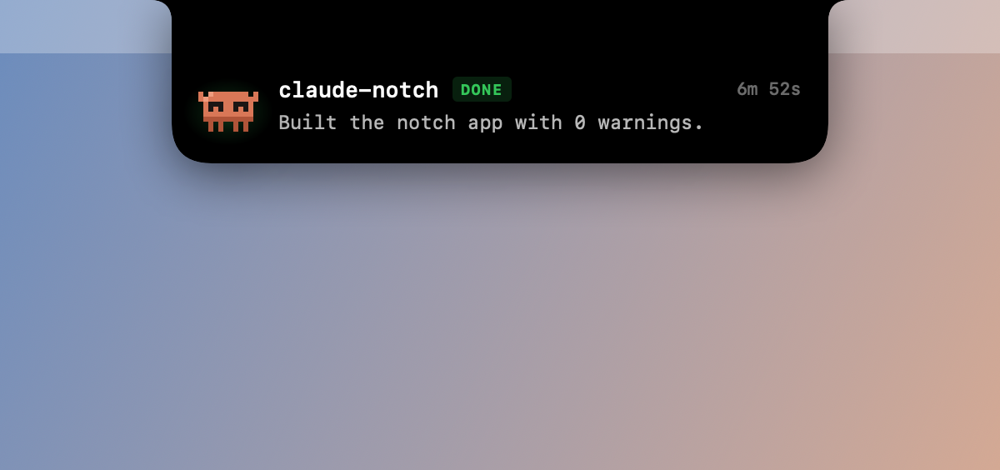
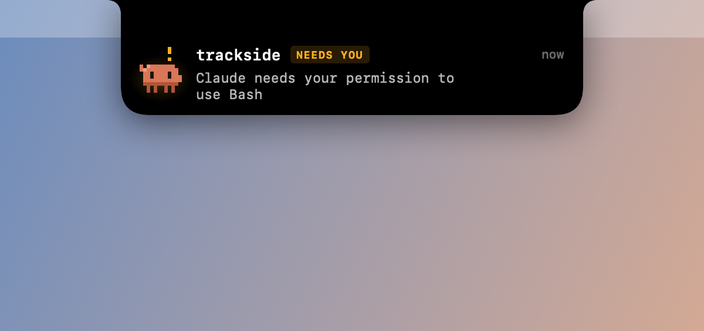
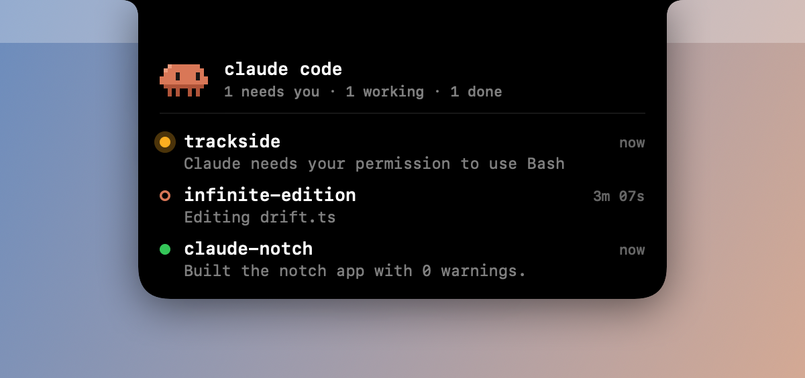
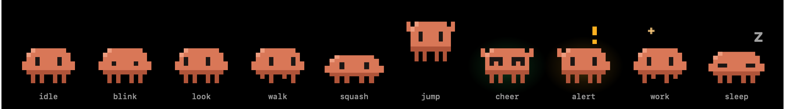
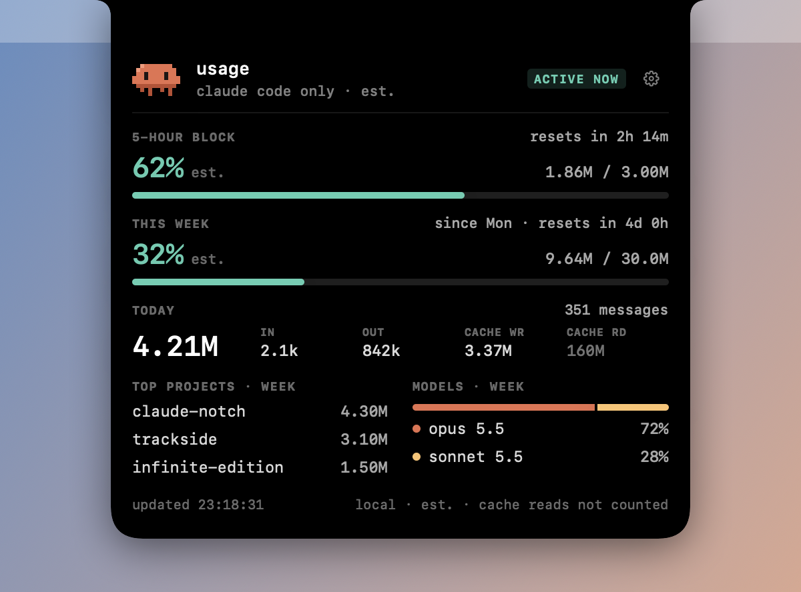

# Claude Notch

A Dynamic Island for Claude Code on notched MacBooks. A small pixel Claude lives next to
the camera, reacts to what Claude is doing, and drops down like a notification when a task
finishes or Claude needs you.



- **Resting:** the notch grows two small ears. The character lives in the left one: it
  breathes, blinks, wanders and hops while idle, scurries while Claude works, and dozes off
  when nothing is running. The right ear shows Claude's thinking spinner, a `!` when Claude
  needs you, or a check when it's done.
- **Pop-down:** when Claude finishes or asks for permission, the notch drops down with the
  project, what happened (the summary comes from Claude's final message) and how long the
  turn took. Click it to jump to the exact Terminal or iTerm2 tab.
- **Hover** the notch to see every running session at once. Click a row to jump to it.
- Right-click for **Mute Pop-downs**, **Usage Details** and **Quit**.

Native Swift (AppKit + SwiftUI), no dependencies, no Dock icon. Respects Reduce Motion and
stops animating while the display sleeps or the screen is locked.

| Working | Needs you | Every session on hover |
|---|---|---|
|  |  |  |



## Usage bar

A thin bar hangs under the notch and shows how much of your 5-hour Claude Code window is
spent, with the time until it resets. Click it for the full picture.




- **Always visible, never in the way.** The bar fills with the share of your 5-hour estimate:
  calm under 75%, amber from 75%, red from 90%. A dot beside the label means a message landed in
  the last two minutes. It sits below the menu bar, so it never covers a menu bar item.
- **Click it** (or right-click the notch, Usage Details) for Today, the 5-hour block with its
  reset countdown, This week, tokens in / out / cache, your top three projects, the per-model
  split and when it last updated. The gear opens the limit settings. The panel closes when you
  click elsewhere or a few seconds after the pointer leaves.
- **No notch?** On an external display or a Mac without a notch, the same percentage appears
  in the menu bar and opens the same panel.
- **Notifications** at 75% and 90% of the 5-hour estimate, once per block each (toggle in
  settings, on by default). Right-click the notch, Hide Usage Bar, to turn the whole thing off.

### How the numbers are computed

Claude Code writes a transcript per session under `~/.claude/projects/**/*.jsonl`. Every
assistant message carries its `usage` (input, output, cache creation, cache read tokens).

- **Deduped** by `message.id` + `requestId`: streamed replies repeat the same message, and the
  largest count of each field wins, so a reply is counted once at its final size. Malformed
  lines and Claude Code's `<synthetic>` placeholder messages are ignored.
- **Counted tokens** are input + output + cache creation. Cache reads repeat the same context
  every turn and dwarf everything else, so they are shown but not counted unless you switch
  *count cache reads* on.
- **Today** is local midnight to now. **This week** starts on the weekday you pick (Monday by
  default) at local midnight. Both follow your time zone, including DST days.
- **5-hour block** follows the convention popular usage tools use: a block starts at the first
  message after the previous block ended, floored to the hour (UTC), and runs five hours. The
  bar tracks the block that contains now; with none active it shows *no active block*.
- **Incremental.** The app remembers a byte offset per file and reads only what was appended,
  streaming line by line with a byte-level prefilter so large transcripts are never loaded
  whole or fully decoded. A full first scan of ~400 MB of transcripts takes about 0.4 s, and an
  unchanged refresh reads nothing. Refreshes come from file-system events (at most one scan per
  3 s while Claude is streaming) plus a 30 s timer. Files untouched for 10 days are skipped.

### The "est." caveat

Anthropic exposes no API for plan limits, and this app never touches claude.ai or any
credentials. You set your own 5-hour and weekly token limits in the panel's settings (the
defaults, 3M and 30M, are placeholders), and every percentage is labeled **est.** against those
numbers. They are estimates of Claude Code usage only: chat on claude.ai, the desktop app and
API usage are not counted, and the real limits are not necessarily token counts. Limits can
also be set from a terminal:

```bash
defaults write com.joshdare.ClaudeNotch usage.limit5h -int 4000000
defaults write com.joshdare.ClaudeNotch usage.limitWeek -int 40000000
```

### Privacy

Everything is local and read-only. The app parses the transcripts already on your Mac but keeps
only token counts, timestamps, the model and the folder name in memory. Message text is never
stored, logged or sent anywhere, and the only thing it writes is its own settings in UserDefaults.

### Tests and checks

```bash
./scripts/test.sh            # unit tests: dedupe, malformed lines, chunked reads, block boundaries across midnight and DST, week start
./scripts/usage-summary.sh   # run the engine on your real ~/.claude/projects: totals, scan time (numbers only, no contents)
```

## How it works

```
Claude Code hooks ──▶ hooks/session_state.py ──▶ ~/.claude/mascot/sessions/<id>.json ──▶ ClaudeNotch.app
```

The hook runs on SessionStart, UserPromptSubmit, Pre/PostToolUse (async, so it never adds
tool latency), Notification, Stop and SessionEnd. It writes one small JSON file per session.
The app watches that folder, ranks sessions by urgency, and drives the character and the
pop-downs. Sessions that die without SessionEnd are cleaned up by PID.

## Requirements

- macOS 14 or later. Built for notched MacBooks; other displays get a virtual notch.
- [Claude Code](https://docs.anthropic.com/en/docs/claude-code), Python 3, and `swiftc`
  (Xcode or the Command Line Tools: `xcode-select --install`).

## Install

```bash
./scripts/install.sh                 # build, copy to ~/Applications, start at login
python3 scripts/wire_hooks.py        # preview the settings.json change
python3 scripts/wire_hooks.py --apply  # write it (a backup is made first)
```

New Claude Code sessions pick up the hooks. The first time you click a pop-down, macOS asks
to let Claude Notch control Terminal. That permission is what lets it select the right tab.

## Demo and snapshots

```bash
./scripts/demo.sh                                                       # ~17s hands-free loop in the real notch for ⌘⇧5 recording; Return restores the live notch
~/Applications/ClaudeNotch.app/Contents/MacOS/ClaudeNotch --snapshot out # every state rendered to PNG, usage bar and panel included
```

## Uninstall

```bash
./scripts/uninstall.sh
```

Removes the app, the login agent, the hook entries (settings.json is backed up first) and the
state files under `~/.claude/mascot`.

## Build notes

`scripts/build.sh` compiles with plain `swiftc` instead of `swift build`. Some Command Line
Tools installs ship a PackageDescription library that's out of sync with the compiler, and
`swift build` fails on those before it reaches any code.

## License

MIT © 2026 Joshua Dare. An unofficial community project, not affiliated with or endorsed by
Anthropic. Claude is a trademark of Anthropic, PBC.
