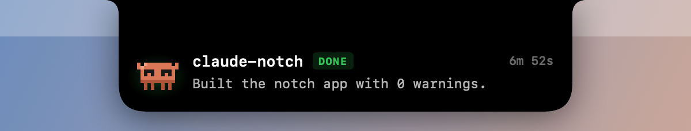
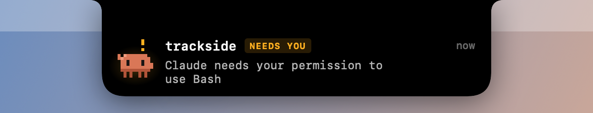
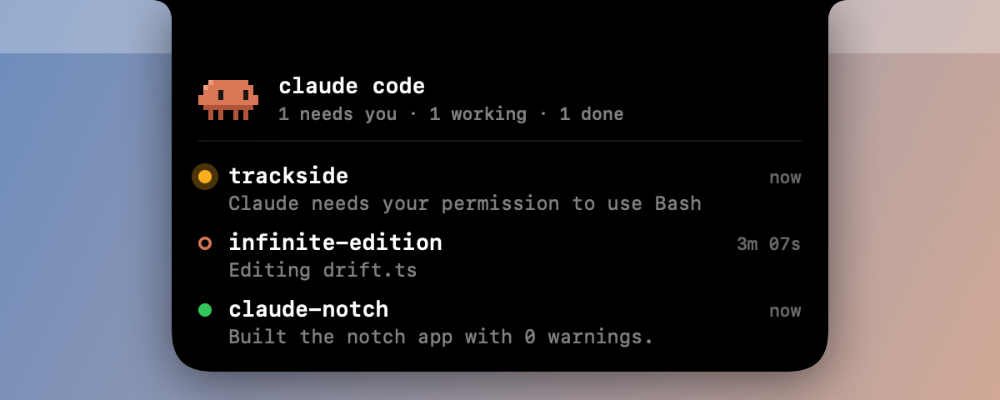
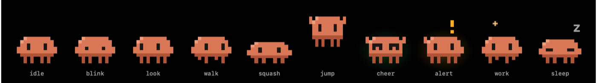

# Claude Notch

A Dynamic Island for Claude Code on notched MacBooks. A small pixel Claude lives next to
the camera, reacts to what Claude is doing, and drops down like a notification when a task
finishes or Claude needs you.



- **Resting:** the notch grows two small ears. The character lives in the left one: it
  breathes, blinks, wanders and hops while idle, scurries while Claude works, and dozes off
  when nothing is running. The right ear shows Claude's thinking spinner, a `!` when Claude
  needs you, or a check when it's done.
- **Pop-down:** when Claude finishes or asks for permission, the notch drops down with the
  project, what happened (the summary comes from Claude's final message) and how long the
  turn took. Click it to jump to the exact Terminal or iTerm2 tab.
- **Hover** the notch to see every running session at once. Click a row to jump to it.
- Right-click for **Mute Pop-downs** and **Quit**.

Native Swift (AppKit + SwiftUI), no dependencies, no Dock icon. Respects Reduce Motion and
stops animating while the display sleeps or the screen is locked.

| Working | Needs you | Every session on hover |
|---|---|---|
|  |  |  |



## How it works

```
Claude Code hooks ──▶ hooks/session_state.py ──▶ ~/.claude/mascot/sessions/<id>.json ──▶ ClaudeNotch.app
```

The hook runs on SessionStart, UserPromptSubmit, Pre/PostToolUse (async, so it never adds
tool latency), Notification, Stop and SessionEnd. It writes one small JSON file per session.
The app watches that folder, ranks sessions by urgency, and drives the character and the
pop-downs. Sessions that die without SessionEnd are cleaned up by PID.

## Requirements

- macOS 14 or later. Built for notched MacBooks; other displays get a virtual notch.
- [Claude Code](https://docs.anthropic.com/en/docs/claude-code), Python 3, and `swiftc`
  (Xcode or the Command Line Tools: `xcode-select --install`).

## Install

```bash
./scripts/install.sh                 # build, copy to ~/Applications, start at login
python3 scripts/wire_hooks.py        # preview the settings.json change
python3 scripts/wire_hooks.py --apply  # write it (a backup is made first)
```

New Claude Code sessions pick up the hooks. The first time you click a pop-down, macOS asks
to let Claude Notch control Terminal. That permission is what lets it select the right tab.

## Demo and snapshots

```bash
./scripts/demo.sh                                                       # ~17s hands-free loop in the real notch for ⌘⇧5 recording; Return restores the live notch
~/Applications/ClaudeNotch.app/Contents/MacOS/ClaudeNotch --snapshot out # every state rendered to PNG
```

## Uninstall

```bash
./scripts/uninstall.sh
```

Removes the app, the login agent, the hook entries (settings.json is backed up first) and the
state files under `~/.claude/mascot`.

## Build notes

`scripts/build.sh` compiles with plain `swiftc` instead of `swift build`. Some Command Line
Tools installs ship a PackageDescription library that's out of sync with the compiler, and
`swift build` fails on those before it reaches any code.

## License

MIT © 2026 Joshua Dare. An unofficial community project, not affiliated with or endorsed by
Anthropic. Claude is a trademark of Anthropic, PBC.
