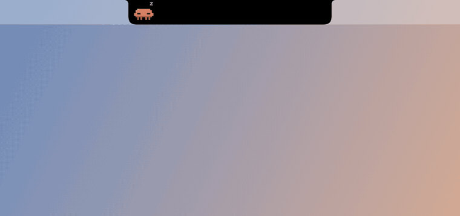
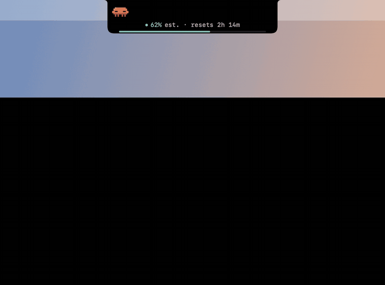

# Claude Notch

A Dynamic Island for Claude Code on notched MacBooks. A pixel Claude lives beside the camera, shows what each session is doing, and drops down when a task finishes or needs you.



```bash
./scripts/install.sh                   # build, copy to ~/Applications, start at login
python3 scripts/wire_hooks.py --apply  # add the Claude Code hooks (settings.json is backed up first)
```

Run `python3 scripts/wire_hooks.py` without `--apply` to preview the change. New Claude Code sessions pick up the hooks. Requires macOS 14+, Python 3 and `swiftc` (`xcode-select --install`).

## What it does

- **Resting:** the character breathes and wanders while idle, scurries while Claude works, and sleeps when nothing is running.
- **Pop-down:** when Claude finishes or asks for permission, the notch shows the project, a summary from Claude's final message and how long the turn took. Click to jump to the exact Terminal or iTerm2 tab.
- **Hover:** every running session, ranked by urgency.
- **Usage bar:** your 5-hour window under the notch, with a full breakdown one click away.



## How it works

```
Claude Code hooks ──▶ hooks/session_state.py ──▶ ~/.claude/mascot/sessions/<id>.json ──▶ ClaudeNotch.app
```

- **Native and dependency-free.** Swift, AppKit and SwiftUI, compiled with plain `swiftc`. No Dock icon. It respects Reduce Motion and stops animating while the display sleeps or the screen is locked.
- **Hooks never slow Claude down.** Tool hooks run async and write one small JSON file per session. The app watches the folder, and sessions that die without a SessionEnd are cleaned up by PID.
- **Usage comes from local transcripts.** Assistant messages in `~/.claude/projects/**/*.jsonl` are deduped by `message.id` + `requestId`, so a streamed reply counts once at its final size. Cache reads are shown but not counted by default.
- **Incremental scanning.** The app keeps a byte offset per file and reads only what was appended, streaming line by line with a byte-level prefilter. A first scan of about 400 MB takes about 0.4 s, and an unchanged refresh reads nothing.
- **Private by construction.** It never touches claude.ai or any credentials. Only token counts, timestamps, the model and the folder name stay in memory. Message text is never stored, logged or sent anywhere.

## Limits

- **Usage percentages are estimates.** Anthropic exposes no API for plan limits, so you set your own in the panel (the 3M and 30M defaults are placeholders), and every figure is labeled `est.`. Claude.ai chat, the desktop app and API usage aren't counted.
- **Built for notched MacBooks.** Other displays get a virtual notch, and the usage percentage moves to the menu bar.
- **Tab jumping needs permission.** macOS asks once to let it control Terminal.

## Development

```bash
./scripts/test.sh                                    # 119 checks: dedupe, malformed lines, chunked reads, block boundaries across midnight and DST
./scripts/usage-summary.sh                           # run the engine on your own transcripts (numbers only)
./scripts/demo.sh                                    # hands-free loop in the real notch, for recording
build/ClaudeNotch.app/Contents/MacOS/ClaudeNotch --snapshot out   # render every state to PNG
./scripts/uninstall.sh                               # remove the app, login agent, hooks and state files
```

`scripts/build.sh` uses `swiftc` because `swift build` fails on Command Line Tools installs whose PackageDescription is out of sync with the compiler.

Last run on 2026-11-17: `./scripts/test.sh` passed **119 of 119 checks**, and `./scripts/build.sh` built and signed the app with Swift 6.3.

## Status

Working macOS app. It runs at login on its author's MacBook through the login agent that `install.sh` sets up. There is no pre-built download yet: you build it from source with the two commands at the top.

## Roadmap

- A notarized, pre-built release, so installing doesn't need `swiftc`.
- Tab jumping for more terminals than Terminal and iTerm2.

## Credits

Built by [Akinwale Dare](https://github.com/Waleee7).

Rashaun Booker (@RaeBooker) — project contributor; documentation and setup guidance.

## License

MIT © 2026 Akinwale Dare. An unofficial community project, not affiliated with or endorsed by Anthropic. Claude is a trademark of Anthropic, PBC.
